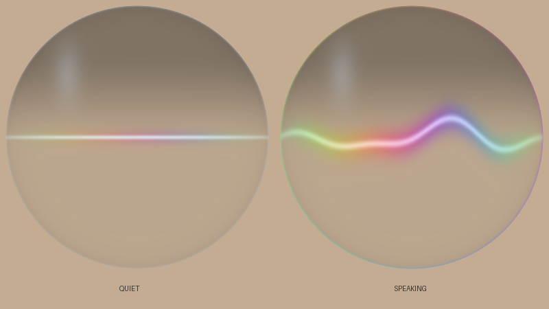

# Microphone-reactive liquid-glass orb

Open **Super+Shift+Space**, then click the microphone. The search capsule
shortens, becomes circular, and expands into an 88 px voice orb at the same
center. Search controls fade out before the centered voice wave appears.
The 520 ms transition uses one persistent liquid-glass surface, with live
desktop blur and refraction. Its blur buffers keep the same size during morphing.
Click the orb or press **Escape** to stop capture and morph back to search.
Closing the menu also stops capture. The orb visualizes microphone amplitude
independently of optional offline dictation. If the speech model or recognizer
is unavailable, the orb stays open and shows the setup error below it; click
the orb or press Escape to return to search.



The preview above shows the transparent voice overlay on a neutral background;
the running UI supplies the live liquid-glass background underneath it.

## Components

- [LumaMicOrb.qml](../config/quickshell/MacShell/LumaMicOrb.qml): reusable visual,
  with a public `micVolume` real property, a replaceable `shaderUrl`, and
  frame-driven animation. It interpolates the 30 Hz envelope for smooth motion.
- [LumaMicrophone.qml](../config/quickshell/MacShell/LumaMicrophone.qml): owns one
  supervised `Quickshell.Io.Process` and parses newline-delimited JSON with
  `SplitParser`. `active: false` sends SIGTERM, clears the level, and releases
  the recorder. Errors are exposed through `error`; there is no restart loop.
- [mic_level.py](../config/quickshell/MacShell/bin/mic_level.py): Python standard
  library only. Captures raw mono signed 16-bit PCM from native PipeWire
  `pw-cat`, falling back to PulseAudio `parec` (also works with pipewire-pulse).
- [luma-mic-orb.frag](../config/quickshell/MacShell/luma-mic-orb.frag): a circular,
  transparent overlay with a centered voice wave and spectral highlights.
  [LumaSearchGlass.qml](../config/quickshell/MacShell/LumaSearchGlass.qml) supplies
  desktop blur and refraction beneath it. A centered gradient line is
  used when Qt is running with its software renderer.

The stream is direct:

```text
default microphone → pw-cat / parec → PCM RMS → JSON stdout
    → Process.stdout / SplitParser → microphone.volume
    → LumaMicOrb.micVolume → ShaderEffect.micVolume
```

This avoids a subprocess per frame, shell pipelines, temporary volume files and
per-frame IPC calls. Audio is processed in memory and discarded, without being
saved or sent anywhere. The recorder follows the audio server's default-source
selection policy; restarting capture selects the current default input.

## Minimal integration

Use the components in the existing MacShell directory, which also supplies
`LumaSearchGlass.qml`, its shader, and `bin/mic_level.py`:

```qml
import QtQuick

Item {
    id: root
    width: 160; height: 160
    property bool listening: false

    LumaMicrophone {
        id: microphone
        active: root.listening && root.visible
    }
    LumaMicOrb {
        anchors.fill: parent
        micVolume: microphone.volume
        animate: microphone.active
    }
    MouseArea {
        anchors.fill: parent
        onClicked: root.listening = !root.listening
    }
}
```

## Use an existing external shader

Qt 6 `ShaderEffect` consumes a compiled `.qsb` package rather than raw GLSL.
Keep the editable `.frag` source and compile it after changes:

```bash
cd config/quickshell/MacShell
/usr/lib/qt6/bin/qsb --qt6 -o shader.frag.qsb shader.frag
```

Use `qsb` from your Qt installation if it lives elsewhere. Set
`shaderUrl: Qt.resolvedUrl("shader.frag.qsb")` on `LumaMicOrb`.
The bundled wave uses `luma-mic-orb.frag`, compiled to
`luma-mic-clear.frag.qsb`. Its distinct resource URL avoids reusing the old inset
sphere from Qt's shader cache during a live reload. The shared glass fades its
exterior rim to zero in voice mode, leaving no halo outside the circle.
Voice mode also fades both blur passes, grain, and flat tint to zero, then samples
the sharp backdrop directly for refraction. The orb overlay supplies a black
upper cap that fades vertically into clear glass at the bottom.
The bundled component exposes these properties directly on its `ShaderEffect`:

```qml
property real micVolume: root.animatedLevel // normalized and interpolated
property real iTime: root.phase            // continuous animation phase
property vector2d resolution: Qt.vector2d(width, height)
```

A compatible fragment shader starts with:

```glsl
#version 440
layout(location = 0) in vec2 qt_TexCoord0;
layout(location = 0) out vec4 fragColor;
layout(std140, binding = 0) uniform buf {
    mat4 qt_Matrix;
    float qt_Opacity;
    float micVolume;
    float iTime;
    vec2 resolution;
};
// Use micVolume to modulate wave amplitude, distortion and spectral highlights.
// Write premultiplied output: vec4(color * alpha, alpha) * qt_Opacity.
```

The Qt-defined uniforms must stay first. Keep the QML and GLSL property names
identical. The bundled shader keeps the outer silhouette circular and morphs
the wave inside it. Its alpha stays translucent so it composes over the glass.
`LumaMicOrb.glassBackground` defaults to `true` for standalone use. The search
view sets it to `false` and reuses the morphing search capsule as the background.

## Meter settings and standalone use

```bash
python3 -u config/quickshell/MacShell/bin/mic_level.py
python3 -u config/quickshell/MacShell/bin/mic_level.py --backend=pulse
python3 -u config/quickshell/MacShell/bin/mic_level.py --backend=pipewire --source=NODE_NAME
```

Each flushed line is a JSON event:

```json
{"event":"status","backend":"pipewire","status":"connecting"}
{"event":"level","volume":0.68123}
```

The level measures live PCM amplitude, rather than the microphone gain slider.
RMS is converted to dBFS, mapped from **−58 dBFS → 0** to **−12 dBFS → 1**,
and clamped. Attack is 35 ms; release is 220 ms. Capture uses 16 kHz mono PCM,
with approximately 30 updates per second. Tune sensitivity with `--floor-db`
and `--ceiling-db`, and update frequency with `--fps` (10–60).

Override `LumaMicrophone.command` to pass these options from QML. Do not run the
reader through `StdioCollector.onStreamFinished`, which waits until capture
ends; `SplitParser.onRead` delivers every complete line while capture runs.

## Validation and references

```bash
python3 -B -m unittest discover -s config/quickshell/MacShell/tests -p 'test_mic_level.py' -v
python3 -B -m unittest discover -s config/quickshell/MacShell/tests -p 'test_luma_search.py' -v
```

Tests use synthetic PCM and mock recorders instead of opening a real microphone.
They check normalization, attack/release, streaming, SIGTERM cleanup, QML
activation/close behavior, stable centers, capsule-to-circle geometry, hidden
search controls, and interruption/reversal of the morph. The shader package is
compiled with `qsb`; preview
images are rendered from the GLSL with Mesa OpenGL.

Implementation references: [Qt ShaderEffect](https://doc.qt.io/qt-6/qml-qtquick-shadereffect.html),
[Quickshell Process](https://quickshell.org/docs/v0.2.1/types/Quickshell.Io/Process/),
[Quickshell SplitParser](https://quickshell.org/docs/v0.2.1/types/Quickshell.Io/SplitParser/),
[PipeWire pw-cat](https://docs.pipewire.org/page_man_pw-cat_1.html).
